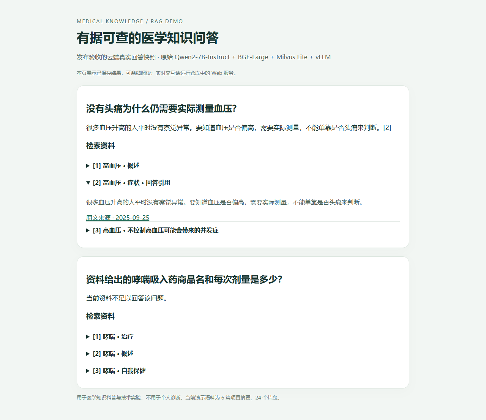
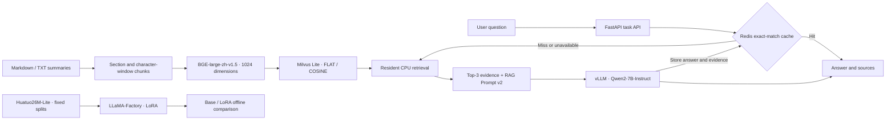
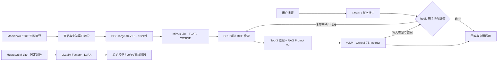

# Medical Question Answering with a Domain-Adapted LLM and RAG

[English](#english) · [中文](#中文)

---

<a name="english"></a>

## English

A Chinese medical knowledge QA system built on **Qwen2-7B-Instruct**, covering medical QA preparation, LoRA domain adaptation, retrieval, source citations, and a web application. Fixed data splits support model evaluation; retrieved evidence supports traceable answers; resident services and Redis caching improve response time.

### Results

- **30,000 medical QA training pairs:** fine-tuned with LLaMA-Factory and LoRA on one GPU. Character-level ROUGE-L F1 increased from **16.81 to 26.91 (+10.10 points)** on the same 500-question held-out test set.
- **Traceable RAG:** Markdown/TXT parsing, section and character-window chunking, BGE-Large embeddings, Milvus Lite retrieval, and answers with source evidence.
- **Serving pipeline:** FastAPI with resident CPU retrieval and GPU vLLM inference. Redis reuses answers for identical questions, with TTL and failure fallback.
- **Measured latency:** across five sequential service tests, the first task took 7.97 s and the remaining tasks took 0.75–1.49 s. Three paired cache checks recorded **38.3–52.8 ms** for cache-hit tasks.

ROUGE-L is the mean per-question character-level LCS F1, measuring text overlap. Latency is server-side task time, excluding service startup, browser polling, and external network transit. See the [experiment report](docs/experiment_report.md) for measurement conditions.

### Architecture



[View the saved examples offline](docs/demo.html) by downloading the file and opening it in a browser. The screenshot contains recorded acceptance-test answers; the running web service supports live questions.



The online demo uses **base Qwen2-7B-Instruct + RAG**. The 30k LoRA model is retained for domain adaptation and offline comparison. Deployment selection was based on answer completeness and citation behavior on development questions.

### Implementation

| Component | Implementation |
|---|---|
| Data and training | Fixed seed, rule-based deduplication, 30k / 500 / 500 split; LLaMA-Factory, LoRA, BF16 |
| Text processing | Markdown/TXT; section chunks, 300-character windows with 40-character overlap for long sections; source, location, and hash metadata |
| Retrieval | SentenceTransformers, BGE-large-zh-v1.5, 1024 dimensions; Milvus Lite, COSINE, Top-3 |
| Generation | Qwen2-7B-Instruct, Prompt v2, vLLM OpenAI-compatible API |
| Web | FastAPI, task polling, Chinese UI, answer and evidence display |
| Cache | Redis, question and version-context hash keys, TTL, failure fallback |
| Evaluation | Character-level ROUGE-L F1, Hit@K / MRR, per-question evidence checks, serial task timing, automated tests |

The demo corpus contains **6 project-authored summaries of public material, split into 24 chunks**. This system supports medical knowledge education and technical experiments, not personal diagnosis.

### Quick start

Validated environment: Linux, Python 3.12, NVIDIA A10. Training, retrieval, and generation use separate environments. Follow the [setup guide](docs/reproduction.md) to prepare dependencies, models, and the index. Startup scripts assume the /mnt/workspace layout.

```bash
cd /mnt/workspace/RAGDemo
RAG_ENABLE_CACHE=1 bash scripts/start_resident_cloud.sh
curl -fsS http://127.0.0.1:8001/v1/models
curl -fsS http://127.0.0.1:8002/health
curl -fsS http://127.0.0.1:8000/health
```

Open port 8000 through your server's port access entry. Ask “没有头痛为什么仍需要实际测量血压？” to inspect an answer and supporting passages. Ask “资料给出的哮喘吸入药商品名和每次剂量是多少？” to inspect insufficient-evidence handling. Repeat an identical question to exercise the cache.

```bash
curl -sS http://127.0.0.1:8000/api/jobs \
  -H 'Content-Type: application/json' \
  -d '{"question":"没有头痛为什么仍需要实际测量血压？"}'
# Poll with the returned id: GET /api/jobs/{id}
```

Run source tests locally without downloading model weights:

```bash
python -m unittest discover -s tests
```

### Documentation

Detailed supporting documents are currently in Chinese.

| Topic | Link |
|---|---|
| Experiment design, results, and model selection | [Experiment report](docs/experiment_report.md) |
| Environment, data, training, and evaluation | [Setup guide](docs/reproduction.md) |
| Parsing and indexing | [Text corpus](docs/text_corpus_v2.md) |
| Resident services | [Deployment](docs/resident_services.md) |
| Cache keys, TTL, and fallback | [Redis cache](docs/answer_cache.md) |
| Frozen release and acceptance checks | [Release notes](docs/release_v1.md) |
| Diagnostic experiments | [Experiment index](docs/experiments/README.md) |
| Data and model provenance | [Sources](docs/sources_and_release.md) |

Source code lives in app/ and scripts/, configuration in configs/, experiment materials in experiments/, and tests in tests/. Weights, raw medical QA data, runtime outputs, and credentials are stored separately. This repository provides code, configuration, summary documents, and aggregate evaluation results.

[Back to language selection](#medical-question-answering-with-a-domain-adapted-llm-and-rag)

---

<a name="中文"></a>

## 中文

**Medical Question Answering with a Domain-Adapted LLM and RAG**

基于 Qwen2-7B-Instruct 的中文医学知识问答项目，覆盖医疗 QA 数据处理、LoRA 领域适配、知识库检索、来源引用和 Web 服务。通过固定数据划分衡量微调效果，通过可追溯证据组织回答，通过常驻服务与 Redis 缓存改善交互体验。

### 项目成果

- **30,000 条医疗 QA 微调**：使用 LLaMA-Factory 和 LoRA 完成单卡训练，在同一 500 题保留测试集上，字符级 ROUGE-L F1 从 **16.81 提升至 26.91（+10.10 分）**。
- **可追溯的 RAG 问答**：实现 Markdown/TXT 解析、章节与字符窗口切分、BGE-Large 向量化、Milvus Lite 检索、回答引用与来源展示。
- **可交互的部署链路**：FastAPI、CPU 常驻检索、GPU vLLM 推理；Redis 支持完全相同问题的答案复用、TTL 和故障回退。
- **有记录的工程优化**：五次串行服务测试中，首个任务 7.97 秒，其余 0.75–1.49 秒；另三组缓存配对测试中，命中任务耗时 **38.3–52.8 毫秒**。

ROUGE-L 为逐题字符 LCS F1 均值，衡量文本重合度；延迟为服务端任务耗时，不含服务启动、浏览器轮询及外部网络。完整条件见[实验报告](docs/experiment_report.md)。

### 系统架构


[离线查看这组真实运行样例](docs/demo.html)（下载后用浏览器打开）。截图展示保存的验收回答；运行 Web 服务后可实时提问。



在线演示采用 **原始 Qwen2-7B-Instruct + RAG**；30k LoRA 作为领域适配与离线对照模型。该选择依据开发题中的回答完整性与引用表现，微调产物和评估流程均保留。

### 技术实现

| 模块 | 实现 |
|---|---|
| 数据与微调 | 固定种子、规则去重、30k / 500 / 500 划分；LLaMA-Factory、LoRA、BF16 |
| 文本处理 | Markdown / TXT；按章节切分，长章节 300 字符窗口、40 字符重叠；来源、位置与哈希 |
| 向量检索 | SentenceTransformers、BGE-large-zh-v1.5、1024 维；Milvus Lite、COSINE、Top-3 |
| 生成 | Qwen2-7B-Instruct、Prompt v2、vLLM OpenAI-compatible API |
| Web | FastAPI、任务状态轮询、中文网页、答案与检索证据展示 |
| 缓存 | Redis、问题与版本上下文哈希键、TTL、故障回退 |
| 验证 | 字符级 ROUGE-L F1、Hit@K / MRR、逐题证据核对、串行任务计时、自动化测试 |

当前演示知识库为 **6 篇项目编写的公开资料摘要、24 个片段**。系统面向医学知识科普与技术实验，不用于个人诊断。

### 快速运行

已验证环境：Linux、Python 3.12、NVIDIA A10。训练、检索与生成采用分离环境。首次运行先按[复现指南](docs/reproduction.md)准备依赖、模型和索引；启动脚本默认使用 /mnt/workspace 布局。

```bash
cd /mnt/workspace/RAGDemo
RAG_ENABLE_CACHE=1 bash scripts/start_resident_cloud.sh
curl -fsS http://127.0.0.1:8001/v1/models
curl -fsS http://127.0.0.1:8002/health
curl -fsS http://127.0.0.1:8000/health
```

通过服务器端口入口打开 8000/。提问“没有头痛为什么仍需要实际测量血压？”查看回答及支持片段；提问“资料给出的哮喘吸入药商品名和每次剂量是多少？”查看资料不足处理；再次提交完全相同的问题查看缓存复用。

```bash
curl -sS http://127.0.0.1:8000/api/jobs \
  -H 'Content-Type: application/json' \
  -d '{"question":"没有头痛为什么仍需要实际测量血压？"}'
# 使用返回的 id 查询：GET /api/jobs/{id}
```

本地源码测试无需下载模型：

```bash
python -m unittest discover -s tests
```

### 阅读导航

| 内容 | 入口 |
|---|---|
| 实验设计、结果与模型选择 | [实验报告](docs/experiment_report.md) |
| 环境、数据、训练与评估 | [复现指南](docs/reproduction.md) |
| 解析与入库 | [文本知识库](docs/text_corpus_v2.md) |
| 常驻服务 | [部署说明](docs/resident_services.md) |
| 缓存键、TTL 与回退 | [Redis 缓存](docs/answer_cache.md) |
| 冻结版本与验收 | [发布说明](docs/release_v1.md) |
| 已有诊断实验档案 | [实验索引](docs/experiments/README.md) |
| 数据与模型来源 | [来源说明](docs/sources_and_release.md) |

代码在 app/、scripts/，配置在 configs/，复现材料在 experiments/，测试在 tests/。模型权重、原始医疗 QA、运行输出和凭据单独保存；仓库提供源码、配置、摘要语料与评估汇总。
