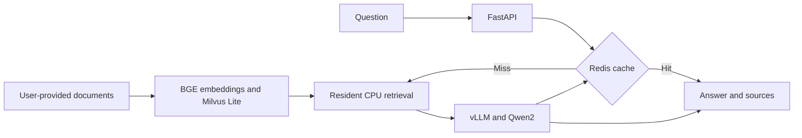
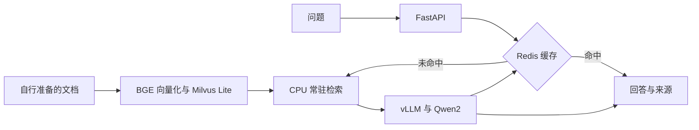

# Medical Question Answering with a Domain-Adapted LLM and RAG

[English](#english) · [中文](#中文)

<a name="english"></a>

## English

A Chinese medical knowledge QA system built with Qwen2-7B-Instruct, BGE-Large, Milvus Lite, vLLM, FastAPI, and Redis. It includes data preparation, LoRA domain adaptation, evidence retrieval, source-linked answers, and service deployment.

### Engineering features

- **Domain adaptation:** data validation, deduplication, fixed splits, and LLaMA-Factory LoRA training configurations.
- **Evidence retrieval:** Markdown/TXT ingestion, section-aware chunking, BGE embeddings, and Milvus Lite similarity search.
- **Answer generation:** retrieved passages and source metadata are included in the prompt; the web UI displays answers and supporting evidence.
- **Serving:** resident CPU retrieval and GPU vLLM inference behind a FastAPI task API.
- **Caching:** Redis exact-question caching with version-aware keys, TTL, and failure fallback.

The serving configuration uses the base Qwen2 model with RAG; LoRA training is provided as a separate workflow. This repository publishes source code, configuration, and unit tests. Training data, corpus content, recorded answers, and evaluation results are not distributed in the current source tree.

### Architecture



### Setup

Use a CUDA-enabled Linux environment for GPU inference. Install the web dependencies from requirements.txt, the cache dependencies from requirements/cache.txt, and a compatible vLLM stack. Retrieval needs sentence-transformers, pymilvus, and milvus-lite in its own environment.

Prepare authorized Markdown/TXT documents outside the repository. Each document must contain a title line, a source URL line prefixed with 来源：, an ISO date line prefixed with 版本：, and sections beginning with two hash characters. Build the index with an explicit corpus path:

```bash
python -m scripts.build_text_index \
  --corpus /path/to/authorized/corpus \
  --model-dir /mnt/workspace/models/bge-large-zh-v1.5 \
  --output outputs/retrieval_v2
```

Review scripts/start_resident_cloud.sh before launch: it expects Qwen2 weights at /mnt/workspace/models/Qwen2-7B-Instruct, BGE weights at /mnt/workspace/models/bge-large-zh-v1.5, and a retrieval interpreter at /mnt/workspace/envs/rag-retrieval-v1/bin/python. Install vLLM and the web dependencies for /usr/local/bin/python; install Redis server if caching is enabled.

```bash
RAG_ENABLE_CACHE=1 bash scripts/start_resident_cloud.sh
curl -fsS http://127.0.0.1:8001/v1/models
curl -fsS http://127.0.0.1:8002/health
curl -fsS http://127.0.0.1:8000/health
```

Access the web application on port 8000 through a trusted network or SSH tunnel. Review network exposure before deployment. Data preparation and evaluation scripts accept external inputs; local corpus and experiment paths in their defaults must be supplied separately.

Run unit tests without model weights:

```bash
python -m unittest discover -s tests
```

See [sources and distribution](docs/sources_and_release.md) for provenance. This software supports medical knowledge retrieval and does not provide personal diagnosis.

---

<a name="中文"></a>

## 中文

基于 Qwen2-7B-Instruct、BGE-Large、Milvus Lite、vLLM、FastAPI 和 Redis 的中文医疗知识问答系统，涵盖数据处理、LoRA 领域适配、证据检索、来源引用与服务部署。

### 工程能力

- **领域适配：**数据校验、去重、固定划分及 LLaMA-Factory LoRA 训练配置。
- **证据检索：**Markdown/TXT 入库、按章节切分、BGE 向量化与 Milvus Lite 相似度检索。
- **回答生成：**将检索片段及来源信息组织进提示词，网页展示回答及支持证据。
- **服务部署：**CPU 常驻检索、GPU vLLM 推理，FastAPI 提供任务接口。
- **答案缓存：**Redis 完全匹配缓存、版本感知键、TTL 与故障回退。

在线配置使用 Qwen2 基座模型加 RAG，LoRA 训练作为独立流程提供。当前源码目录公开代码、配置和单元测试，不分发训练数据、知识库正文、历史回答或评测结果。

### 系统架构



### 启动说明

GPU 推理使用支持 CUDA 的 Linux 环境。网页依赖见 requirements.txt，缓存依赖见 requirements/cache.txt；另安装兼容的 vLLM 环境。检索环境需要 sentence-transformers、pymilvus 和 milvus-lite。

在仓库外准备有权使用的 Markdown/TXT 文档。每份文档需包含标题行、以“来源：”开头的来源 URL、以“版本：”开头的 ISO 日期，以及由两个井号开头的章节。使用显式语料路径构建索引：

```bash
python -m scripts.build_text_index \
  --corpus /path/to/authorized/corpus \
  --model-dir /mnt/workspace/models/bge-large-zh-v1.5 \
  --output outputs/retrieval_v2
```

启动前检查 scripts/start_resident_cloud.sh：脚本要求 Qwen2 权重位于 /mnt/workspace/models/Qwen2-7B-Instruct，BGE 权重位于 /mnt/workspace/models/bge-large-zh-v1.5，检索解释器位于 /mnt/workspace/envs/rag-retrieval-v1/bin/python。为 /usr/local/bin/python 安装 vLLM 和网页依赖；启用缓存时安装 Redis 服务端。

```bash
RAG_ENABLE_CACHE=1 bash scripts/start_resident_cloud.sh
curl -fsS http://127.0.0.1:8001/v1/models
curl -fsS http://127.0.0.1:8002/health
curl -fsS http://127.0.0.1:8000/health
```

通过可信网络或 SSH 隧道访问 8000 端口的网页，部署前检查网络暴露范围。数据处理与评测脚本接受外部输入，其默认路径中的本地语料和实验文件需要自行准备。

无需模型权重即可运行单元测试：

```bash
python -m unittest discover -s tests
```

数据来源见[来源与发布说明](docs/sources_and_release.md)。系统用于医疗知识检索，不提供个人诊断。
